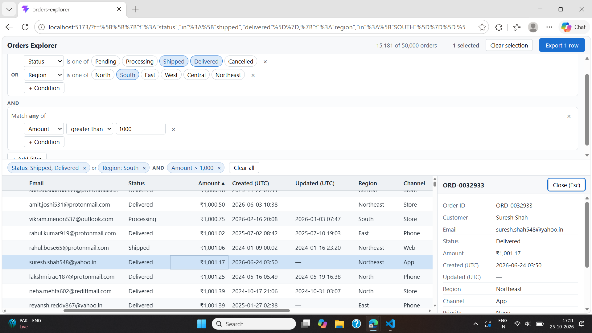
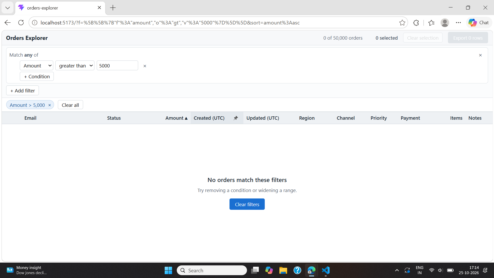

# Orders Explorer

A single-screen tool for exploring about 50,000 orders. It has a hand-built virtualized data grid and a hand-built filter builder, both driven by one state that lives in the URL. React, TypeScript, Vite.

## 1. How to run

Requires Node 24 and npm.

```bash
npm install
npm run dev          # http://localhost:5173
```

Other commands:

```bash
npm run build           # type check + production build
npm run preview         # serve the production build
npm run check:data      # data cleaning rules, run on the real file
npm run check:filters   # filter engine compared with plain loops
npm run check:url       # URL round trip and broken URLs
npm run check:csv       # CSV escaping and row counts
npm run bench           # timings on 50,000 rows
```

## 2. Screenshots

Main screen: filters, chips, sort, selection and the details panel.



Empty state: the filter matches nothing.



## 3. Dependencies

Runtime:

- `react`: UI library.
- `react-dom`: renders React in the browser.

Dev only: `typescript`, `vite`, `@vitejs/plugin-react`, `oxlint` (all from the Vite template) and `tsx` (runs the check scripts in Node).

No table, grid, virtualization, query-builder, router or state library is used.

## 4. Data loading

- `orders.json` is in `public/` and fetched at runtime. Importing 17 MB of JSON would bloat the JS bundle and block the main thread.
- Parsing, cleaning (all 10 rules in `docs/data-notes.md`) and de-duplication run in a **Web Worker**, so the page stays responsive and shows a loading state.
- All cleaning lives in `src/data/normalize.ts` and `src/data/dedupe.ts`. No cell or filter code fixes data.
- 50,030 records become 50,000 unique orders. In Node: parse about 85 ms, clean and de-duplicate about 80 ms.

## 5. The 200 rows question

**The export contains all 200 selected rows**, including the 180 hidden by the filter.

- Selecting rows is a deliberate act. A filter only changes the view, so it should not silently throw that work away.
- The screen always matches the file. The top bar says `200 selected (180 hidden by filter)` and the button says `Export 200 rows`.
- For the other behaviour there is a **Deselect hidden** button. One click makes the selection, the count and the export equal to what is visible.
- Rows in the CSV follow the current sort order.

## 6. Design changes

FILL IN

## 7. Known issues

- The selection is stored in the URL as ID ranges. Contiguous rows stay short, but thousands of scattered rows make a very long URL.
- Text sorting compares characters, so `Customer 10` sorts before `Customer 2`. This was chosen for speed. Sorting by ID is not affected.
- All dates are shown and filtered in UTC, not local time.
- No order in the data is above about 3,640 INR, so an amount filter above that gives the empty state.
- The layout is designed for laptop screens (13 inch and up), not phones.
- There is no unit test framework. Correctness is checked by the `check:*` scripts, which run against the real data.
- FILL IN

## Performance (Node, 50,000 rows)

- Filters take 1 to 6 ms and sorts take 6 to 45 ms.
- About 26 rows are in the DOM at any time. Rows are memoized, so a click re-renders about 2 rows.

## Structure

```
src/data        loading, cleaning, de-duplication, worker
src/grid        grid, virtualization, sorting, columns, rows
src/filters     filter model, engine, builder UI, chips
src/url         URL encoding, validation, syncing
src/export      CSV
src/components  details panel, empty state, error banner
scripts         check and benchmark scripts
design          sketches
docs            data notes and screenshots
```